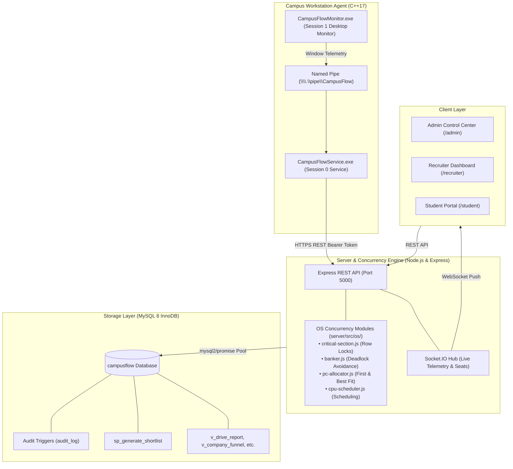
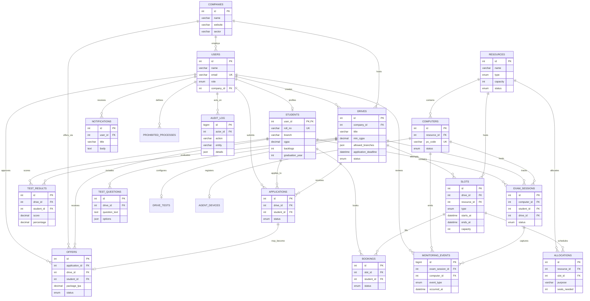

# CampusFlow OS

**The operating system for campus placements.** A complete university recruitment pipeline—drives, aptitude tests, eligibility shortlisting, interview scheduling, and exam workstation control—will be presented as a real-world OS + DBMS project. It simulates how university placement systems coordinate students, recruiters, resources, and exam monitoring without manual chaos.

Built by a 4-member undergraduate team for a Capstone / Project-Based Learning evaluation (Operating Systems + Database Management Systems):
- **Ishika Rawat (Lead):** OS 4 Deadlock Management, OS 8 Agent & Device Control, DBMS 1 Database Design & Schema Management, DBMS 2 Student & Company Management
- **Akansha Parley:** OS 2 Queue Management, OS 7 Exam Environment Monitoring, DBMS 3 Placement Drive Management, DBMS 4 Eligibility & Application Management
- **Trisha Dabral:** OS 1 Task Scheduling, OS 3 Process Synchronization, DBMS 7 Transactions & Concurrency Control, DBMS 8 Queries, Reports & Analytics
- **Akshay Singh Gusain:** OS 5 Resource Allocation, OS 6 Resource Utilization, DBMS 5 Test & Interview Management, DBMS 6 Resource Management

For the complete module distribution, code grounding, and member mappings, see **[docs/PROJECT_MAP.md](docs/PROJECT_MAP.md)**.

---

## 🏛️ System Architecture



## 🧩 Entity Relationship Diagram

The core database model behind CampusFlow is modeled as a placement system with identity, recruitment lifecycle, resource scheduling, and exam monitoring flows. This ER model reflects the schema in `database/schema.sql` and the live functionality implemented across the application.



This ER diagram shows the system at a glance: users and students form the identity layer, drives and applications form the recruitment lifecycle, resources and slots form the scheduling layer, and exam sessions plus monitoring events capture the live proctoring workflow.

Detailed architectural diagrams, sequence diagrams, and design rationales are documented in **[docs/ARCHITECTURE.md](docs/ARCHITECTURE.md)**.

---

## ✨ Features Grounded in Real Code

### 🎓 Student Portal (`/student`)
- **Profile Matching:** Explore drives filtered by CGPA, branch, backlogs, and graduation year (`server/src/dbms/eligibility.js`).
- **1-Click Application:** Validated against criteria; transactions audited by `trg_applications_audit_ai`.
- **Aptitude Testing:** In-app timed MCQ examination with server-side auto-grading (`server/src/os/pipeline.js`).
- **Interview & Test Tracking:** View auto-allocated workstation seats and interview time slots.

### 💼 Recruiter Portal (`/recruiter`)
- **Add Drive Wizard:** 4-step wizard with live eligibility preview (`POST /drives/preview-eligibility`) using MySQL `JSON_CONTAINS`.
- **Pipeline Tracker:** Track candidates across applied, test taken, shortlisted, and selected states.
- **Batch Test Scheduling:** System allocates applicants into lab batches based on real capacity constraints.
- **Interview Timetabling:** Automatic scheduling of shortlisted candidates across interview panels and rooms.

### 🛠️ Admin Control Center (`/admin`)
- **Exam Monitoring (`/admin/monitoring`):** Live terminal status grid receiving agent heartbeats, window focus loss, and blacklisted process alerts via Socket.IO.
- **Live Kernel Monitor (`/admin/monitor`):** Real-time telemetry feed from `lock_events`, showing semaphore acquisitions, waits, and releases with an interactive stress test button.
- **Scheduling Lab (`/admin/scheduling`):** Interactive OS scheduling simulation comparing FCFS, Priority, SJF, SRTF, and Round Robin algorithms with dynamic Gantt charts (`server/src/os/cpu-scheduler.js`).
- **Resources & Labs (`/admin/resources`):** Physical lab and room inventory running Dijkstra's Banker's algorithm (`server/src/os/banker.js`) to reject unsafe allocation requests with HTTP 409.
- **Analytics & Reports (`/admin/reports`):** Powered directly by database views (`v_drive_report`, `v_branch_placement`, `v_company_funnel`, `v_package_stats`).

---

## 🚀 Quick Start for Windows (Node.js + MySQL 8)

For comprehensive setup, troubleshooting, and Linux/Docker alternatives, consult **[docs/03_INSTALLATION.md](docs/03_INSTALLATION.md)**.

### 1. Prerequisites
- **Node.js:** v18.0.0+ (`node --version`)
- **MySQL Server:** v8.0+ running on port `3306` with InnoDB enabled

### 2. Configure Backend
```powershell
cd c:\dev\CampusFlow\server
copy .env.example .env
# Edit .env to set your DB_PASSWORD and a 32+ character JWT_SECRET
npm install
npm run db:reset       # Recreates campusflow database, applies schema, runs seed
npm run dev            # Starts backend API on http://localhost:5000/api
```

### 3. Configure Frontend (in a separate terminal)
```powershell
cd c:\dev\CampusFlow\client
npm install
npm run dev            # Starts Vite development server on http://localhost:5173
```

Open `http://localhost:5173` in your browser.

---

## 🔑 Demo Seed Accounts (Password: `password123`)

| Role | Email | Portal Surface | Purpose |
|---|---|---|---|
| **Admin** | `admin@campusflow.local` | `/admin` | Full system control, Kernel Monitor, Lab allocations, Exam seat map |
| **Recruiter** | `priya@techcorp.com` | `/recruiter` | Drive creation, Aptitude test setup, Shortlisting |
| **Student** | `ishika@student.local` | `/student` | Profile, Drive application, MCQ test taking, Schedule |

One-click demo login buttons are provided directly on the `/login` page.

---

## 📁 Repository Structure

```text
CampusFlow/
├── client/                     # Vite + React SPA (Tailwind CSS)
│   └── src/
│       ├── pages/admin/        # KernelMonitor, ExamMonitoring, SchedulingLab, Resources
│       ├── pages/recruiter/    # NewDriveWizard, RecruiterDashboard, MyDrives
│       └── pages/student/      # StudentDashboard, Drives, TestTaker, StudentJourney
├── database/                   # MySQL Schema, Migrations & Evidence
│   ├── schema.sql              # Canonical 3NF DDL, Constraints, Triggers, Procedures, Views
│   ├── migrate_v*.sql          # Versioned schema migrations
│   └── demo/                   # Individual SQL viva evidence scripts
│       ├── member1_ishika.sql
│       ├── member2_akansha.sql
│       ├── member3_trisha.sql
│       └── member4_akshay.sql
├── docs/                       # Grounded System Documentation & Manuals
│   ├── PROJECT_MAP.md          # 16-module verified code mapping and ownership
│   ├── OS_MANUAL.md            # 8 OS modules: Concepts, Code, Demos
│   ├── DBMS_MANUAL.md          # 8 DBMS modules: Tables, ACID, Queries, Triggers
│   ├── ER_DIAGRAM.md           # Mermaid erDiagram, 1NF/2NF/3NF notes, Schema catalog
│   ├── ARCHITECTURE.md         # System architecture, sequence diagrams, design decisions
│   ├── VIVA_GUIDE.md           # Member pitches, 40 Q&As, 20 hard defenses, live tasks
│   ├── DEMO_SCRIPT.md          # 15-20 min choreographed viva script with wow moments
│   ├── KNOWN_ISSUES.md         # Candid technical boundaries & scope disclosures
│   └── 03_INSTALLATION.md      # Detailed installation and setup guide
├── server/                     # Node.js Express REST API
│   └── src/
│       ├── os/                 # OS logic: banker.js, pc-allocator.js, cpu-scheduler.js, critical-section.js
│       ├── dbms/               # DB connectivity (db.js), eligibility.js, transactions.js
│       └── routes/             # admin/, agent.js, monitor.js, drives.js, resources.js
└── windows-agent/              # C++17 Windows Monitoring Agent
    ├── src/service/            # CampusFlowService.exe (Session 0 service)
    ├── src/monitor/            # CampusFlowMonitor.exe (Session 1 desktop observer)
    └── tools/mock-server.js    # In-memory mock server for cross-platform testing
```

---

## 📜 Available Scripts

| Directory | Command | Description |
|---|---|---|
| `server/` | `npm run dev` | Runs backend API server with nodemon |
| `server/` | `npm run db:reset` | Drops and recreates database, applies schema and seeds fresh data |
| `server/` | `npm run db:migrate` | Runs any pending versioned migration scripts |
| `client/` | `npm run dev` | Starts Vite client dev server on port 5173 |
| `client/` | `npm run build` | Compiles production assets into `client/dist/` |
| `windows-agent/`| `build.bat` | Compiles C++ service and monitor using CMake / MSBuild |

---

## 📖 Comprehensive Documentation Suite

- **[Project Map (16 Modules)](docs/PROJECT_MAP.md)**: Authoritative ownership, file citations, and route mapping.
- **[Operating Systems Manual](docs/OS_MANUAL.md)**: Deep dive into the 8 OS modules with exact code citations.
- **[Database Management Manual](docs/DBMS_MANUAL.md)**: Deep dive into the 8 DBMS modules, ACID analysis, and triggers.
- **[ER Diagram & Normalization](docs/ER_DIAGRAM.md)**: Full Mermaid ER model, normal form evaluations, and index catalogs.
- **[System Architecture](docs/ARCHITECTURE.md)**: Flowcharts, sequence diagrams, and 14 code-backed design decisions.
- **[Viva Voce Guide](docs/VIVA_GUIDE.md)**: 30-second pitches, 10 questions per member, hard defenses, and live tasks.
- **[Master Demo Script](docs/DEMO_SCRIPT.md)**: 15–20 minute choreographed presentation with 4 "Wow Moments".
- **[Known Issues & Disclosures](docs/KNOWN_ISSUES.md)**: Honest engineering disclosures on unbuilt and out-of-scope items.
