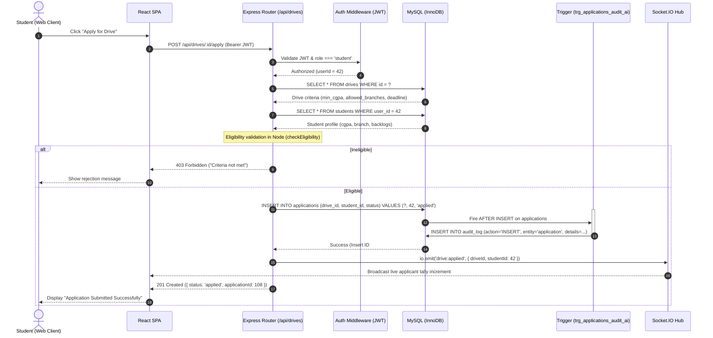

# CampusFlow System Architecture & Design Specification

## 1. High-Level System Architecture

CampusFlow bridges a modern web-based campus recruitment portal with an operating system kernel monitor and a low-level native Windows monitoring agent.

```mermaid
graph TB
    subgraph ClientLayer ["Client Layer (Presentation)"]
        SPA["React SPA (Vite + Tailwind CSS)"]
        UI_Admin["Admin Portal (/admin/*)"]
        UI_Student["Student Portal (/student/*)"]
        UI_Recruiter["Recruiter Portal (/recruiter/*)"]
        SPA --- UI_Admin
        SPA --- UI_Student
        SPA --- UI_Recruiter
    end

    subgraph ServerLayer ["Server & Application Layer (Node.js & Express)"]
        API["Express REST API (Port 5000)"]
        AuthMW["Auth & RBAC Middleware"]
        RouteDrives["/api/drives"]
        RoutePC["/api/pc & /api/resources"]
        RouteAgent["/api/agent (Agent Gateway)"]
        RouteMonitor["/api/monitor (Telemetry & Stress)"]
        RouteOS["/api/os (CPU & Banker Simulation)"]
        SocketServer["Socket.IO Server (Real-Time Pub/Sub)"]
        
        API --> AuthMW
        AuthMW --> RouteDrives
        AuthMW --> RoutePC
        AuthMW --> RouteAgent
        AuthMW --> RouteMonitor
        AuthMW --> RouteOS
        API --- SocketServer
    end

    subgraph OSLayer ["OS & Concurrency Engine (server/src/os/)"]
        CS["Critical Section Manager (critical-section.js)"]
        PCAlloc["PC & Lab Allocator (pc-allocator.js)"]
        Banker["Banker's Deadlock Algorithm (banker.js)"]
        CPUSched["Task Scheduler Simulation (cpu-scheduler.js)"]
        LockMgr["Lock Telemetry Logger (locks.js)"]

        RoutePC --> PCAlloc
        RoutePC --> Banker
        RouteMonitor --> CS
        RouteOS --> CPUSched
        CS --> LockMgr
        PCAlloc --> LockMgr
    end

    subgraph DatabaseLayer ["Database & Storage Layer (MySQL 8 / InnoDB)"]
        DB[(MySQL Database `campusflow`)]
        InnoDB["InnoDB Storage Engine (Row-Level Locking)"]
        Triggers["Audit Triggers (AFTER INSERT/UPDATE/DELETE)"]
        StoredProc["Stored Procedure: sp_generate_shortlist"]
        Views["Analytical Views (v_drive_report, v_company_funnel, etc.)"]
        AuditTable["audit_log & lock_events"]

        DB --- InnoDB
        DB --- Triggers
        DB --- StoredProc
        DB --- Views
        Triggers --> AuditTable
    end

    subgraph AgentLayer ["Campus Terminal Agent (Windows Native C++17)"]
        subgraph Session0 ["Windows Session 0 (Isolated Non-Interactive)"]
            Service["CampusFlowService.exe (Background Windows Service)"]
            PipeServer["Named Pipe Server (\\\\.\\pipe\\CampusFlow)"]
            HTTPClient["HTTP Client (WinINet / libcurl)"]
            Service --- PipeServer
            Service --- HTTPClient
        end

        subgraph Session1 ["Windows Interactive User Session (Desktop GUI)"]
            Monitor["CampusFlowMonitor.exe (Desktop Process)"]
            PipeClient["Named Pipe Client"]
            WinHooks["Win32 Hook / Poller (GetForegroundWindow)"]
            ProcDetect["Process Enumerator (EnumProcesses)"]
            Monitor --- PipeClient
            Monitor --- WinHooks
            Monitor --- ProcDetect
        end
    end

    %% Network & IPC Interconnects
    SPA -->|"HTTP/HTTPS REST Requests"| API
    SocketServer -->|"WebSocket / Polling Events (agent:event, agent:heartbeat)"| SPA
    ServerLayer -->|"Connection Pool (mysql2/promise)"| DB
    Monitor -->|"Local IPC (Named Pipe)"| PipeServer
    HTTPClient -->|"HTTPS REST Telemetry & Heartbeat (Bearer Token)"| RouteAgent
    RouteAgent -->|"Push Event Notice"| SocketServer
```



---

## 2. Sequence Diagrams

### 2.1 (a) Student Applies to a Placement Drive

This flow traces a student submitting an application, evaluating prerequisites, acquiring locks where needed, triggering database audits, and broadcasting live count updates to recruiters and administrators.



---

### 2.2 (b) Two Admins Concurrently Allocate the Same Computer (Row Lock & 409 Conflict)

Demonstrates operating system mutual exclusion and transaction isolation in action. Two administrators simultaneously attempt to allocate the exact same workstation (`computerId = 7`) to two different candidates.

```mermaid
sequenceDiagram
    autonumber
    actor Admin1 as Administrator 1
    actor Admin2 as Administrator 2
    participant API as Express API (pc-allocator.js)
    participant DB as MySQL (InnoDB)
    participant LockLog as lock_events Table

    Admin1->>API: POST /api/pc/allocate { computerId: 7, studentId: 101 }
    Admin2->>API: POST /api/pc/allocate { computerId: 7, studentId: 102 }

    critical Worker 1 enters critical section
        API->>DB: START TRANSACTION (Conn 1)
        API->>DB: SELECT * FROM computers WHERE id = 7 FOR UPDATE (Conn 1)
        Note over DB: InnoDB grants Exclusive Row Lock (X-Lock) on Computer #7 to Conn 1
        API->>LockLog: INSERT INTO lock_events ('computer:7', 'admin-1', 'acquire')
        DB-->>API: Computer #7 Record (status = 'available')
    end

    critical Worker 2 attempts entry
        API->>DB: START TRANSACTION (Conn 2)
        API->>DB: SELECT * FROM computers WHERE id = 7 FOR UPDATE (Conn 2)
        Note over DB: Conn 2 BLOCKS waiting for X-Lock on row 7
        API->>LockLog: INSERT INTO lock_events ('computer:7', 'admin-2', 'wait')
    end

    Note over API,DB: Conn 1 proceeds inside Critical Section
    API->>DB: INSERT INTO exam_sessions (computer_id=7, student_id=101, status='scheduled')
    API->>DB: UPDATE computers SET status = 'allocated' WHERE id = 7
    API->>DB: COMMIT (Conn 1)
    Note over DB: Conn 1 commits. Exclusive lock on row 7 is RELEASED.
    API->>LockLog: INSERT INTO lock_events ('computer:7', 'admin-1', 'release')
    API-->>Admin1: 200 OK ({ success: true, sessionId: 301, pc: 'PC-LAB1-07' })

    critical Worker 2 unblocks & inspects state
        Note over DB: Conn 2 acquires X-Lock on row 7 and resumes
        DB-->>API: Computer #7 Record (status = 'allocated')
        Note over API: Condition check fails: pc.status !== 'available'
        API->>DB: ROLLBACK (Conn 2)
        Note over DB: Conn 2 releases lock
        API->>LockLog: INSERT INTO lock_events ('computer:7', 'admin-2', 'release')
    end

    API-->>Admin2: 409 Conflict ("Computer PC-LAB1-07 is not available; current status: allocated")
```

---

### 2.3 (c) Window-Switch Telemetry Flow (Monitor → Pipe → Service → Server → DB → Socket.IO → Seat Map)

Demonstrates how a student switching windows on a physical exam workstation triggers low-level OS detection, crosses the Session 0 boundary via named pipe IPC, transmits over HTTPS, records in the DB, and live-updates the proctoring dashboard.

```mermaid
sequenceDiagram
    autonumber
    actor Student as Student in Lab
    participant WinOS as Windows Desktop OS
    participant Monitor as CampusFlowMonitor.exe (Session 1)
    participant Pipe as Named Pipe (\\.\pipe\CampusFlow)
    participant Service as CampusFlowService.exe (Session 0)
    participant API as Agent Gateway (/api/agent/events)
    participant DB as MySQL (monitoring_events)
    participant WS as Socket.IO Server
    participant AdminUI as ExamMonitoring.jsx (Proctor UI)

    Student->>WinOS: Presses Alt+Tab (Switches from "CampusFlow Exam" to "discord.exe")
    WinOS->>Monitor: GetForegroundWindow() returns hWnd of Discord
    Note over Monitor: Window detector extracts Title: "Discord - #general"<br/>Process Name: "discord.exe"
    
    Monitor->>Pipe: WriteFile(pipeHandle, JSON_PAYLOAD)
    Note over Pipe: Inter-Process Communication crosses Session boundary
    Pipe-->>Service: ReadFile() receives JSON packet

    Note over Service: Service validates packet & prepares HTTPS POST with Bearer Token
    Service->>API: POST /api/agent/events<br/>Headers: Authorization: Bearer <hash><br/>Body: { computerId: 7, eventType: 'WINDOW_SWITCH', windowTitle: 'Discord', processName: 'discord.exe' }

    API->>DB: SELECT * FROM agent_devices WHERE token_hash = SHA256(token)
    DB-->>API: Device verified (computer_id: 7, status: 'online')

    API->>DB: SELECT id FROM exam_sessions WHERE computer_id = 7 AND status = 'active'
    DB-->>API: Active Session ID: 301

    API->>DB: INSERT INTO monitoring_events (exam_session_id=301, computer_id=7, event_type='WINDOW_SWITCH', window_title='Discord', process_name='discord.exe', occurred_at=NOW())
    DB-->>API: Event Logged (ID #8904)

    API->>WS: io.emit('agent:event', { computerId: 7, eventType: 'WINDOW_SWITCH', title: 'Discord', process: 'discord.exe', timestamp: '...' })
    
    WS-->>AdminUI: Push WebSocket Packet ('agent:event')
    Note over AdminUI: Seat Map updates computer card #7 border to RED Flashing Flag<br/>Adds entry to Live Incident Telemetry Feed
    AdminUI-->>Admin1: Proctor sees live visual alert on terminal #7
```



---

## 3. Design Decisions Log ("Why We Did It This Way")

Every architecture decision is grounded in real requirements and implementation details in `server/`, `database/`, and `windows-agent/`.

| # | Architecture Decision | Alternative Considered | Engineering Rationale & Grounding in Code |
|---|---|---|---|
| 1 | **Database Row-Level Locking (`SELECT ... FOR UPDATE`) over in-memory Node.js mutex** | In-memory mutex library (`async-mutex`) or Node.js variables | Node.js runs as a single process in development, but production deployments frequently run multiple cluster workers (or PM2 instances) behind a reverse proxy. An in-memory mutex only serializes within a single thread/process. MySQL InnoDB row-level locking (`pc-allocator.js`, `critical-section.js`) guarantees mutual exclusion across any number of clustered backend nodes directly at the database engine layer. |
| 2 | **Server-Authoritative Exam Session State** | Agent-Authoritative (Agent decides when exam starts, pauses, or terminates) | Workstations in physical labs can be tampered with by technically adept students. If the local agent had authority to submit test scores or terminate an exam, local memory patching or reverse engineering could be used to cheat. In CampusFlow (`agent.js`, `pc-allocator.js`), the server holds exclusive authority over session lifecycle; the agent is strictly an untrusted observation sensor. |
| 3 | **Two-Process Agent Architecture (`Service` + `Monitor`) to solve Session 0 Isolation** | Single monolithic Windows Service executing all monitoring tasks | Since Windows Vista, Windows Services execute exclusively in **Session 0**, an isolated, non-interactive session devoid of a graphical desktop, window manager, or user input queue. A service calling `GetForegroundWindow()` or `GetDesktopWindow()` in Session 0 returns `NULL` or service windows. CampusFlow (`windows-agent/src/`) splits duties: `CampusFlowService.exe` runs in Session 0 for elevated OS privileges, persistence, and HTTP transport; `CampusFlowMonitor.exe` is launched inside the student's interactive session (Session 1+) using `CreateProcessAsUser` to observe GUI windows. |
| 4 | **Local Named Pipe (`\\.\pipe\CampusFlow`) for Agent IPC** | Local TCP Loopback Sockets (`127.0.0.1:port`) or Shared Memory | Local TCP ports can trigger Windows Defender Firewall prompts, can collide with other installed software, and allow any unprivileged local process to connect and spoof telemetry. Windows Named Pipes (`pipe_server.cpp`, `pipe_client.cpp`) support native Windows Access Control Lists (DACLs) and security descriptors, ensuring only authenticated processes running on the local host can communicate across the session boundary. |
| 5 | **Cryptographic Token Hashing (SHA-256) for Agent Device Authentication** | Plaintext API keys or static credentials in config files | If an intruder gains unauthorized read access to the database (SQL injection or backup leak), storing plaintext agent tokens would allow full impersonation of all campus lab computers. CampusFlow (`agent_devices.token_hash` in `schema.sql`) hashes agent bearer tokens with SHA-256 before storage; the server hashes incoming bearer tokens on the fly before executing lookups. |
| 6 | **Proctoring Flags as Human Review Signals, Not Automatic Cheating Adjudication** | Automated test termination or automated student disqualification | Accidental actions (OS background notifications, antivirus popups, inadvertent key combinations like Alt+Tab) frequently cause transient focus loss. Automatically failing students causes false accusations. In CampusFlow (`monitoring_events.review_status` ENUM `'new','reviewed','dismissed'`), every event is treated as non-destructive evidence for proctors to review in the proctoring dashboard (`ExamMonitoring.jsx`). |
| 7 | **Strict Student Privacy Guardrails in Monitoring Agent** | Full screen capture streaming, webcam surveillance, keylogging | Full screen streaming saturates campus network bandwidth (500 simultaneous streams can overwhelm 1 Gbps switches) and creates privacy liabilities regarding personal messages or stored files. The CampusFlow agent (`window_detector.cpp`, `process_detector.cpp`) inspects only the foreground window title string and executable name. It captures zero keystrokes, zero screenshots, and zero audio/video. |
| 8 | **Separation of Analytical OS Lab Simulation vs. Live Production Engine** | Mixing simulated scheduling runs into real drive records | OS Lab algorithms (FCFS, Priority, SJF, Round Robin in `cpu-scheduler.js`) are pedagogical tools used to demonstrate scheduling heuristics under synthetic workloads in `SchedulingLab.jsx`. Live booking and resource assignment (`critical-section.js`, `pc-allocator.js`) operate on production transactional tables. Keeping simulation isolated under `/api/os/schedule/run` prevents mock experiments from corrupting recruitment records. |
| 9 | **Banker's Algorithm for Multi-Resource Allocation Safety (`banker.js`)** | First-Come-First-Served blind reservation or static quotas | During recruitment drives, multiple companies simultaneously request multi-tier resources (e.g., Computer Lab 1 with 60 seats + 3 Interview Rooms + 2 Technical Interviewers). Blind allocation can lead to circular-wait deadlock scenarios where no company has sufficient resources to complete their round. CampusFlow uses Banker's algorithm (`checkAllocation` in `server/src/os/banker.js`) to reject allocations (HTTP 409) that would steer the campus resource matrix into an unsafe state. |
| 10 | **Virtual Stored Column for Unique Active Session Constraint (`active_computer_id`)** | Application-level `COUNT(*)` checks in Node.js before inserting | Relying on `SELECT COUNT(*) WHERE computer_id = ? AND status = 'active'` allows race conditions where two simultaneous transactions pass the select check before either commits. MySQL does not allow partial unique indexes with WHERE clauses natively; CampusFlow (`schema.sql` line 328) creates a generated virtual column:  
`active_computer_id INT GENERATED ALWAYS AS (IF(status IN ('scheduled', 'active'), computer_id, NULL)) STORED` with a `UNIQUE KEY (active_computer_id)`. MySQL InnoDB strictly prevents duplicate active sessions at the storage engine level. |
| 11 | **Database Triggers for Tamper-Evident Audit Trails (`audit_log`)** | Application-level logging functions (`logger.info`) in Express controllers | Application-level logging can be accidentally omitted by developers, bypassed during direct database maintenance, or suppressed if the Node process crashes mid-request. In CampusFlow (`schema.sql` lines 371-446), MySQL triggers (`AFTER INSERT/UPDATE/DELETE`) execute automatically inside the same atomic database transaction, ensuring an immutable audit row is written to `audit_log` whenever critical entities change. |
| 12 | **Best-Fit Allocation Strategy for Computer Labs (`pc-allocator.js`)** | First-Fit or Random Lab Selection | Allocating large computer labs (e.g., 120 seats) to small batches (e.g., 15 students) causes heavy external fragmentation, leaving no large contiguous spaces available for major placement tests. CampusFlow's `bestFitLab` function calculates the minimum excess capacity ($\text{capacity} - \text{needed} \ge 0$), reserving large facilities for high-volume recruitment drives. |
| 13 | **Batch Shortlisting via Database Stored Procedure (`sp_generate_shortlist`)** | Querying all students into Node.js memory, filtering via JS loop, and updating one by one | Transferring thousands of student records over the network to Node.js and issuing individual `UPDATE` queries causes massive network overhead and lock thrashing. The `sp_generate_shortlist` procedure (`schema.sql` lines 447-466) performs set-based joins and updates in a single SQL operation inside the MySQL kernel using `JSON_CONTAINS(d.allowed_branches, JSON_QUOTE(s.branch)) = 1`. |
| 14 | **Default MySQL InnoDB Isolation Level (`REPEATABLE READ`)** | `READ COMMITTED` or `SERIALIZABLE` | `READ COMMITTED` allows non-repeatable reads and phantom rows during complex eligibility and reporting passes. `SERIALIZABLE` incurs severe locking contention and deadlocks under concurrent student bookings. InnoDB's default `REPEATABLE READ` uses Multi-Version Concurrency Control (MVCC) with consistent read snapshots, ensuring fast queries without blocking concurrent writers. |

---
*All architectural components, sequence flows, and design decisions are grounded in the verified source files across `client/`, `server/`, `database/`, and `windows-agent/`.*

