# CampusFlow Entity-Relationship Diagram & Schema Specification

## 1. Complete Entity-Relationship Model (Mermaid erDiagram)

The diagram below reflects the exact schema from `database/schema.sql` and the cumulative migrations (`migrate_v2.sql`, `migrate_v3.sql`, `migrate_v5.sql`, `migrate_v10.sql`).

```mermaid
erDiagram
    USERS ||--o| STUDENTS : "identifies (1:0..1)"
    USERS ||--o{ DRIVES : "creates (1:N)"
    USERS ||--o{ OFFERS : "issues (1:N)"
    USERS ||--o{ ALLOCATIONS : "authorizes (1:N)"
    USERS ||--o{ NOTIFICATIONS : "receives (1:N)"
    USERS ||--o{ PROHIBITED_PROCESSES : "defines (1:N)"
    USERS ||--o{ MONITORING_EVENTS : "reviews (1:N)"
    USERS ||--o{ AUDIT_LOG : "acts as (1:N)"
    
    COMPANIES ||--o{ USERS : "employs (1:N)"
    COMPANIES ||--o{ DRIVES : "hosts (1:N)"
    COMPANIES ||--o{ OFFERS : "offers through (1:N)"

    STUDENTS ||--o{ APPLICATIONS : "submits (1:N)"
    STUDENTS ||--o{ BOOKINGS : "reserves (1:N)"
    STUDENTS ||--o{ TEST_RESULTS : "scores (1:N)"
    STUDENTS ||--o{ OFFERS : "awarded (1:N)"
    STUDENTS ||--o{ EXAM_SESSIONS : "assigned (1:N)"

    DRIVES ||--o{ APPLICATIONS : "receives (1:N)"
    DRIVES ||--o{ SLOTS : "contains (1:N)"
    DRIVES ||--o{ OFFERS : "yields (1:N)"
    DRIVES ||--o{ TEST_QUESTIONS : "includes (1:N)"
    DRIVES ||--o| DRIVE_TESTS : "configures (1:0..1)"
    DRIVES ||--o{ TEST_RESULTS : "evaluates (1:N)"
    DRIVES ||--o{ EXAM_SESSIONS : "monitors (1:N)"

    APPLICATIONS ||--o| OFFERS : "promoted to (1:0..1)"

    RESOURCES ||--o{ SLOTS : "allocated to (1:N)"
    RESOURCES ||--o{ ALLOCATIONS : "scheduled for (1:N)"
    RESOURCES ||--o{ COMPUTERS : "houses (1:N)"

    SLOTS ||--o{ BOOKINGS : "fills (1:N)"
    SLOTS ||--o{ ALLOCATIONS : "links to (1:N)"

    COMPUTERS ||--o| AGENT_DEVICES : "enrolled as (1:0..1)"
    COMPUTERS ||--o{ EXAM_SESSIONS : "hosts (1:N)"
    COMPUTERS ||--o{ MONITORING_EVENTS : "emits telemetry (1:N)"

    EXAM_SESSIONS ||--o{ MONITORING_EVENTS : "captures (1:N)"

    USERS {
        int id PK
        varchar name
        varchar email UK
        varchar password_hash
        enum role "student, recruiter, admin"
        boolean is_active
        int company_id FK
        timestamp created_at
    }

    STUDENTS {
        int user_id PK, FK
        varchar roll_no UK
        varchar branch
        decimal cgpa
        int backlogs
        int graduation_year
        varchar phone
        json skills
        json projects
        json certifications
        varchar resume_path
        varchar resume_original_name
        datetime resume_uploaded_at
    }

    COMPANIES {
        int id PK
        varchar name
        varchar website
        varchar sector
        text description
        varchar location
        varchar industry
        varchar hr_contact_email
    }

    DRIVES {
        int id PK
        int company_id FK
        varchar title
        text description
        decimal min_cgpa
        json allowed_branches
        int max_backlogs
        int graduation_year
        datetime application_deadline
        date test_date
        date interview_date
        int test_duration_min
        int interview_duration_min
        int num_interviewers
        decimal min_test_score
        int max_shortlist
        enum status "draft, open, testing, interviews, closed, pending_approval, approved, rejected"
        varchar approval_note
        int reviewed_by FK
        datetime reviewed_at
        int created_by FK
        timestamp created_at
    }

    APPLICATIONS {
        int id PK
        int drive_id FK
        int student_id FK
        enum status "applied, test_taken, shortlisted, rejected, selected, withdrawn"
        timestamp applied_at
    }

    OFFERS {
        int id PK
        int application_id FK, UK
        int drive_id FK
        int student_id FK
        int company_id FK
        decimal package_lpa
        date joining_date
        varchar note
        enum status "offered, accepted, declined, withdrawn"
        int created_by FK
        timestamp created_at
        datetime responded_at
    }

    RESOURCES {
        int id PK
        varchar name
        enum type "lab, room, interviewer"
        int capacity
        varchar location
        enum status "available, maintenance"
    }

    SLOTS {
        int id PK
        int drive_id FK
        int resource_id FK
        enum type "test, interview"
        varchar title
        datetime starts_at
        datetime ends_at
        int capacity
        int booked_count
        tinyint auto_scheduled
    }

    BOOKINGS {
        int id PK
        int slot_id FK
        int student_id FK
        enum status "confirmed, cancelled, waitlist"
        timestamp booked_at
    }

    ALLOCATIONS {
        int id PK
        int resource_id FK
        int slot_id FK
        varchar purpose
        int seats_needed
        datetime starts_at
        datetime ends_at
        int allocated_by FK
        timestamp created_at
    }

    COMPUTERS {
        int id PK
        int resource_id FK
        varchar pc_code UK
        varchar enrollment_code UK
        enum status "available, allocated, maintenance"
        timestamp created_at
    }

    AGENT_DEVICES {
        int id PK
        int computer_id FK, UK
        varchar token_hash
        varchar hostname
        varchar agent_version
        enum status "online, offline"
        timestamp last_heartbeat_at
        varchar last_foreground_title
        varchar last_foreground_process
        timestamp registered_at
    }

    EXAM_SESSIONS {
        int id PK
        int computer_id FK
        int student_id FK
        int drive_id FK
        enum status "scheduled, active, ended"
        varchar exam_window_keyword
        datetime starts_at
        datetime ends_at
        datetime ended_at
        int created_by FK
        int active_computer_id "VIRTUAL/STORED UK"
    }

    PROHIBITED_PROCESSES {
        int id PK
        varchar process_name UK
        int added_by FK
        timestamp created_at
    }

    MONITORING_EVENTS {
        bigint id PK
        int exam_session_id FK
        int computer_id FK
        enum event_type "FOCUS_LOST, WINDOW_SWITCH, WINDOW_MINIMIZED, WINDOW_CLOSED, PROHIBITED_PROCESS, AGENT_DISCONNECTED, AGENT_RECONNECTED"
        varchar window_title
        varchar process_name
        datetime occurred_at
        timestamp received_at
        enum review_status "new, reviewed, dismissed"
        int reviewed_by FK
        text review_note
    }

    TEST_QUESTIONS {
        int id PK
        int drive_id FK
        text question_text
        json options
        tinyint correct_index
        int marks
        timestamp created_at
    }

    DRIVE_TESTS {
        int drive_id PK, FK
        enum test_status "draft, pending_approval, approved, rejected"
        varchar approval_note
        int reviewed_by FK
        datetime reviewed_at
        int duration_minutes
    }

    TEST_RESULTS {
        int id PK
        int drive_id FK
        int student_id FK
        decimal score
        decimal total
        decimal percentage
        json answers
        timestamp submitted_at
    }

    NOTIFICATIONS {
        int id PK
        int user_id FK
        varchar title
        text body
        varchar link
        tinyint is_read
        timestamp created_at
    }

    AUDIT_LOG {
        bigint id PK
        int actor_id FK
        varchar action
        varchar entity
        int entity_id
        json details
        timestamp created_at
    }

    LOCK_EVENTS {
        bigint id PK
        varchar lock_name
        varchar holder
        enum action "acquire, wait, release"
        int wait_ms
        timestamp created_at
    }
```

---

## 2. Database Normalization Analysis

To demonstrate database normalisation in viva examinations, three core tables (`students`, `applications`, and `offers`) are evaluated across 1NF, 2NF, and 3NF, showing hypothetical violations and how the schema avoids them.

### Table 1: `students`
- **Candidate Key / Primary Key:** `user_id` (1:1 with `users.id`) and alternate candidate key `roll_no`.

#### 1NF (First Normal Form)
- **Violation Scenario:** If phone numbers were stored as a comma-separated list `phone = "+919876543210, +919812345678"` or student skills as a single non-atomic string `"Java, C++, OS, DBMS"`, atomic value rules would be violated.
- **How CampusFlow Enforces 1NF:** 
  - Every scalar column holds a single atomic value.
  - While `skills`, `projects`, and `certifications` use MySQL native `JSON` type for flexible candidate portfolio documents, core relational queries filter on atomic attributes (`branch`, `cgpa`, `backlogs`, `graduation_year`).
  - No repeating column groups (e.g., `skill1`, `skill2`, `skill3`) exist.

#### 2NF (Second Normal Form)
- **Rule:** The relation must be in 1NF and have no partial dependencies (no non-prime attribute dependent on a proper subset of a composite candidate key).
- **Violation Scenario:** If `students` had a composite primary key `(user_id, roll_no)` and attributes like `branch` or `cgpa` depended only on `user_id`, or if student records included department info with a composite key `(roll_no, dept_id)` where `dept_name` depended only on `dept_id`.
- **How CampusFlow Enforces 2NF:** 
  - The table uses a single-column primary key `user_id`. 
  - Since the primary key is not composite, partial functional dependencies are mathematically impossible. All attributes functionally depend on the entire candidate key `user_id` (and `roll_no`).

#### 3NF (Third Normal Form)
- **Rule:** The relation must be in 2NF and have no transitive functional dependencies ($X \to Y$ and $Y \to Z$ where $Z$ is non-prime and $Y$ is not a superkey).
- **Violation Scenario:** If `students` stored `user_name`, `email`, and `user_role` directly:
  $$\text{roll\_no} \to \text{user\_id} \to (\text{name, email, role})$$
  Here, `email` would transitively depend on `roll_no` through `user_id`, causing update anomalies (e.g., updating a student's email in `users` would leave stale data in `students`).
- **How CampusFlow Enforces 3NF:** 
  - User identity attributes (`name`, `email`, `password_hash`, `role`) reside solely in `users`.
  - `students` only stores academic/placement profile attributes directly determined by the student persona.
  - Foreign key `FOREIGN KEY (user_id) REFERENCES users(id) ON DELETE CASCADE` avoids transitive duplication.

---

### Table 2: `applications`
- **Primary Key:** `id`
- **Natural Candidate Key:** `(drive_id, student_id)`

#### 1NF (First Normal Form)
- **Violation Scenario:** A single row storing multiple drive IDs for a student: `student_id = 14, drive_ids = "1, 2, 5"`.
- **How CampusFlow Enforces 1NF:** Each row represents exactly one student's application to exactly one drive.

#### 2NF (Second Normal Form)
- **Violation Scenario:** If the table used composite primary key `(drive_id, student_id)` and included drive details like `drive_title`, `company_name`, or student details like `student_cgpa`:
  $$\text{drive\_id} \to \text{drive\_title} \quad (\text{partial dependency on part of composite key})$$
- **How CampusFlow Enforces 2NF:**
  - Neither `drive_title` nor student details are duplicated in `applications`.
  - The only non-key attributes are `status` and `applied_at`, both of which functionally depend on the specific pair `(drive_id, student_id)`.

#### 3NF (Third Normal Form)
- **Violation Scenario:** If `applications` included `company_id` and `company_sector`:
  $$(\text{drive\_id, student\_id}) \to \text{drive\_id} \to \text{company\_id} \to \text{company\_sector}$$
  `company_sector` would be transitively dependent on the application.
- **How CampusFlow Enforces 3NF:**
  - `applications` only holds foreign keys `drive_id` and `student_id`.
  - Company and drive details are retrieved via joins (`JOIN drives ON drives.id = applications.drive_id JOIN companies ON companies.id = drives.company_id`). No transitive data is stored.

---

### Table 3: `offers`
- **Primary Key:** `id`
- **Natural Candidate Key:** `application_id` (1:1 with accepted application)

#### 1NF (First Normal Form)
- **Violation Scenario:** Storing multiple counter-offers or revised package steps in a single delimiter string `package_revisions = "8.5, 9.2, 10.0"`.
- **How CampusFlow Enforces 1NF:** Each offer is a single atomic financial package `package_lpa DECIMAL(6,2)` with an atomic `status ENUM`.

#### 2NF (Second Normal Form)
- **Violation Scenario:** If the candidate key was `(application_id, student_id)` and `student_roll_no` was stored in the table, it would depend solely on `student_id` (partial key dependency).
- **How CampusFlow Enforces 2NF:** The primary key is surrogate `id`, and candidate key `application_id` is a single column. All non-key columns depend on `application_id`.

#### 3NF (Third Normal Form)
- **Violation Scenario:** In the theoretical model, `drive_id`, `student_id`, and `company_id` could be derived from `application_id`:
  $$\text{application\_id} \to \text{drive\_id} \to \text{company\_id}$$
  If `company_name` or `drive_title` were stored in `offers`, they would be transitive dependencies.
- **How CampusFlow Enforces 3NF:**
  - No company metadata (`name`, `location`, `sector`) or drive metadata (`title`, `min_cgpa`) is duplicated.
  - Foreign keys (`drive_id`, `student_id`, `company_id`) in `offers` are indexed for fast referential querying and integrity enforcement, with strict cascading rules (`ON DELETE CASCADE`).

---

## 3. Schema Catalog: Constraints, Indexes, Triggers, Views & Procedures

### 3.1 Primary & Foreign Keys and Check Constraints

| Table | Primary Key | Foreign Keys | Unique / Check Constraints |
|---|---|---|---|
| `users` | `id` | `company_id → companies.id` | `UNIQUE(email)`, role IN ('student','recruiter','admin') |
| `students` | `user_id` | `user_id → users.id (CASCADE)` | `UNIQUE(roll_no)`, `CHECK (cgpa BETWEEN 0 AND 10)`, `CHECK (backlogs >= 0)` |
| `companies` | `id` | None | None |
| `drives` | `id` | `company_id → companies.id` `created_by → users.id` `reviewed_by → users.id` | status IN ('draft','open','testing','interviews','closed','pending_approval','approved','rejected') |
| `applications` | `id` | `drive_id → drives.id (CASCADE)` `student_id → students.user_id (CASCADE)` | `UNIQUE uq_application (drive_id, student_id)` |
| `offers` | `id` | `application_id → applications.id (CASCADE)` `drive_id → drives.id (CASCADE)` `student_id → students.user_id (CASCADE)` `company_id → companies.id (CASCADE)` `created_by → users.id` | `UNIQUE (application_id)`, `CHECK (package_lpa > 0)` |
| `resources` | `id` | None | `CHECK (capacity > 0)`, type IN ('lab','room','interviewer') |
| `slots` | `id` | `drive_id → drives.id (CASCADE)` `resource_id → resources.id (SET NULL)` | `CHECK (capacity > 0)`, `CHECK (booked_count >= 0)`, `CHECK (booked_count <= capacity)`, `CHECK (ends_at > starts_at)` |
| `bookings` | `id` | `slot_id → slots.id (CASCADE)` `student_id → students.user_id (CASCADE)` | `UNIQUE uq_booking (slot_id, student_id)` |
| `allocations` | `id` | `resource_id → resources.id` `slot_id → slots.id (SET NULL)` `allocated_by → users.id` | `CHECK (ends_at > starts_at)` |
| `test_questions`| `id` | `drive_id → drives.id (CASCADE)` | None |
| `drive_tests` | `drive_id` | `drive_id → drives.id (CASCADE)` | None |
| `test_results` | `id` | `drive_id → drives.id (CASCADE)` `student_id → students.user_id (CASCADE)` | `UNIQUE uq_test_result (drive_id, student_id)` |
| `notifications` | `id` | `user_id → users.id (CASCADE)` | None |
| `audit_log` | `id` | `actor_id → users.id (SET NULL)` | None |
| `lock_events` | `id` | None | None |
| `computers` | `id` | `resource_id → resources.id (CASCADE)` | `UNIQUE(pc_code)`, `UNIQUE(enrollment_code)` |
| `agent_devices` | `id` | `computer_id → computers.id (CASCADE)` | `UNIQUE(computer_id)` |
| `exam_sessions` | `id` | `computer_id → computers.id` `student_id → students.user_id (CASCADE)` `drive_id → drives.id (SET NULL)` `created_by → users.id (SET NULL)` | `UNIQUE KEY uq_active_computer_session (active_computer_id)` where active_computer_id is generated STORED column |
| `prohibited_processes` | `id` | `added_by → users.id (SET NULL)` | `UNIQUE(process_name)` |
| `monitoring_events` | `id` | `exam_session_id → exam_sessions.id (SET NULL)` `computer_id → computers.id (CASCADE)` `reviewed_by → users.id (SET NULL)` | None |

### 3.2 Indexes

| Table | Index Name | Columns | Purpose |
|---|---|---|---|
| `students` | `idx_students_branch_cgpa` | `(branch, cgpa)` | Optimizes eligibility evaluation filter |
| `drives` | `idx_drives_status_deadline` | `(status, application_deadline)` | Optimizes open drive listing and auto-closing |
| `applications` | `idx_applications_drive` | `(drive_id, status)` | Fast applicant status counts and shortlist joins |
| `offers` | `idx_offers_student_status` | `(student_id, status)` | Fast offer acceptance query and profile display |
| `offers` | `idx_offers_drive` | `(drive_id)` | Aggregating offers per drive |
| `resources` | `idx_resources_type` | `(type, status)` | Allocator lookup for free labs/rooms |
| `slots` | `idx_slots_drive` | `(drive_id, starts_at)` | Drive schedule sequencing |
| `slots` | `idx_slots_resource` | `(resource_id)` | Resource conflict check |
| `slots` | `idx_slots_auto` | `(drive_id, auto_scheduled)` | Filter scheduler generated slots |
| `bookings` | `idx_bookings_slot` | `(slot_id)` | Concurrency count and student attendee list |
| `allocations` | `idx_allocations_resource_time` | `(resource_id, starts_at, ends_at)`| Banker's algorithm overlap detection |
| `test_questions` | `idx_tq_drive` | `(drive_id)` | Test paper fetching |
| `test_results` | `idx_tr_drive` | `(drive_id, percentage)` | Merit ranking and shortlist cutoff |
| `notifications` | `idx_notif_user` | `(user_id, is_read, created_at)` | Student bell icon badge and unread inbox |
| `audit_log` | `idx_audit_entity` | `(entity, entity_id)` | Entity history lookup |
| `audit_log` | `idx_audit_time` | `(created_at)` | Chronological audit trail |
| `lock_events` | `idx_lock_time` | `(created_at)` | Kernel monitor lock waterfall timeline |
| `lock_events` | `idx_lock_name` | `(lock_name)` | Per-resource contention analytics |
| `computers` | `idx_computers_resource` | `(resource_id)` | Lab seat mapping |
| `computers` | `idx_computers_status` | `(status)` | Real-time computer grid view |
| `agent_devices` | `idx_agent_devices_heartbeat` | `(status, last_heartbeat_at)` | Stale agent deadman detection |
| `agent_devices` | `idx_agent_devices_token` | `(token_hash)` | Fast agent bearer token authentication |
| `exam_sessions` | `idx_exam_sessions_student` | `(student_id)` | Student active session verification |
| `exam_sessions` | `idx_exam_sessions_computer_status` | `(computer_id, status)` | Single active seat enforcement |
| `monitoring_events` | `idx_events_session_occurred` | `(exam_session_id, occurred_at)` | Incident timeline reconstruction |
| `monitoring_events` | `idx_events_computer_occurred` | `(computer_id, occurred_at)` | Machine-level forensics |
| `monitoring_events` | `idx_events_status` | `(review_status)` | Proctor review queue sorting |

### 3.3 Database Triggers

All audit triggers write change telemetry directly to `audit_log` inside MySQL:

| Trigger Name | Event | Table | Action & Payload Logged |
|---|---|---|---|
| `trg_bookings_audit_ai` | AFTER INSERT | `bookings` | Logs `action='INSERT'`, `entity='booking'`, payload `JSON_OBJECT('slot_id', NEW.slot_id, 'student_id', NEW.student_id, 'status', NEW.status)` |
| `trg_bookings_audit_au` | AFTER UPDATE | `bookings` | Logs `action='UPDATE'`, `entity='booking'`, payload `JSON_OBJECT('old_status', OLD.status, 'new_status', NEW.status)` |
| `trg_bookings_audit_ad` | AFTER DELETE | `bookings` | Logs `action='DELETE'`, `entity='booking'`, payload `JSON_OBJECT('slot_id', OLD.slot_id, 'student_id', OLD.student_id)` |
| `trg_applications_audit_ai` | AFTER INSERT | `applications` | Logs `action='INSERT'`, `entity='application'`, payload `JSON_OBJECT('drive_id', NEW.drive_id, 'student_id', NEW.student_id, 'status', NEW.status)` |
| `trg_applications_audit_au` | AFTER UPDATE | `applications` | Logs `action='UPDATE'`, `entity='application'`, payload `JSON_OBJECT('old_status', OLD.status, 'new_status', NEW.status, 'drive_id', NEW.drive_id)` |
| `trg_allocations_audit_ai` | AFTER INSERT | `allocations` | Logs `action='INSERT'`, `entity='allocation'`, payload `JSON_OBJECT('resource_id', NEW.resource_id, 'purpose', NEW.purpose, 'seats_needed', NEW.seats_needed)` |
| `trg_allocations_audit_au` | AFTER UPDATE | `allocations` | Logs `action='UPDATE'`, `entity='allocation'`, payload `JSON_OBJECT('resource_id', NEW.resource_id, 'purpose', NEW.purpose, 'seats_needed', NEW.seats_needed, 'starts_at', NEW.starts_at, 'ends_at', NEW.ends_at)` |
| `trg_allocations_audit_ad` | AFTER DELETE | `allocations` | Logs `action='DELETE'`, `entity='allocation'`, payload `JSON_OBJECT('resource_id', OLD.resource_id, 'purpose', OLD.purpose)` |
| `trg_exam_sessions_audit_ai` | AFTER INSERT | `exam_sessions` | Logs `action='INSERT'`, `entity='exam_session'`, payload `JSON_OBJECT('computer_id', NEW.computer_id, 'student_id', NEW.student_id, 'status', NEW.status)` |
| `trg_exam_sessions_audit_au` | AFTER UPDATE | `exam_sessions` | Logs `action='UPDATE'`, `entity='exam_session'`, payload `JSON_OBJECT('old_status', OLD.status, 'new_status', NEW.status, 'computer_id', NEW.computer_id)` |
| `trg_offers_audit_ai` | AFTER INSERT | `offers` | Logs `action='INSERT'`, `entity='offer'`, payload `JSON_OBJECT('application_id', NEW.application_id, 'student_id', NEW.student_id, 'drive_id', NEW.drive_id, 'package_lpa', NEW.package_lpa, 'status', NEW.status)` |
| `trg_offers_audit_au` | AFTER UPDATE | `offers` | Logs `action='UPDATE'`, `entity='offer'`, payload `JSON_OBJECT('old_status', OLD.status, 'new_status', NEW.status, 'application_id', NEW.application_id, 'student_id', NEW.student_id)` |

### 3.4 Stored Procedures

| Procedure Name | Arguments | Defined In | Purpose & Logic |
|---|---|---|---|
| `sp_generate_shortlist` | `IN p_drive_id INT, OUT p_count INT` | `database/schema.sql` (lines 447-466) | Performs set-oriented batch eligibility evaluation. Updates `applications a JOIN students s JOIN drives d` setting `a.status = 'shortlisted'` or `'rejected'` based on `s.cgpa >= d.min_cgpa`, `s.backlogs <= d.max_backlogs`, `s.graduation_year = d.graduation_year`, and `JSON_CONTAINS(d.allowed_branches, JSON_QUOTE(s.branch)) = 1`. Returns modified row count via `ROW_COUNT()`. |

### 3.5 Views

| View Name | Base Tables | Defined In | Purpose |
|---|---|---|---|
| `v_drive_report` | `drives`, `companies`, `applications`, `students` | `database/schema.sql` (lines 470-483) | Aggregates per-drive recruitment metrics: total applicants, count shortlisted, count selected, and average CGPA of shortlisted/selected candidates. |
| `v_branch_placement` | `students`, `applications`, `offers` | `database/schema.sql` (lines 485-496) | Calculates department-level placement percentage (`COUNT(distinct accepted offers) / COUNT(distinct applicants) * 100`). |
| `v_company_funnel` | `companies`, `drives`, `applications`, `offers` | `database/schema.sql` (lines 497-509) | Generates company hiring funnel: number of drives hosted, applicants received, shortlisted count, selections, and offers issued. |
| `v_package_stats` | `drives`, `offers` | `database/schema.sql` (lines 511-519) | Reports salary distributions: minimum package (`MIN(package_lpa)`), maximum package (`MAX(package_lpa)`), and average package per drive. |

---
*All entities, attributes, constraints, indexes, triggers, procedures, and views in this document match the actual repository definitions in `database/schema.sql` and migration scripts.*

